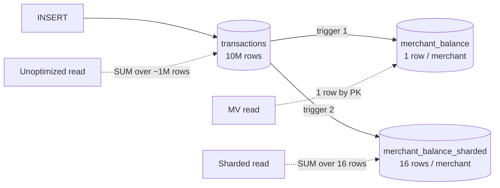
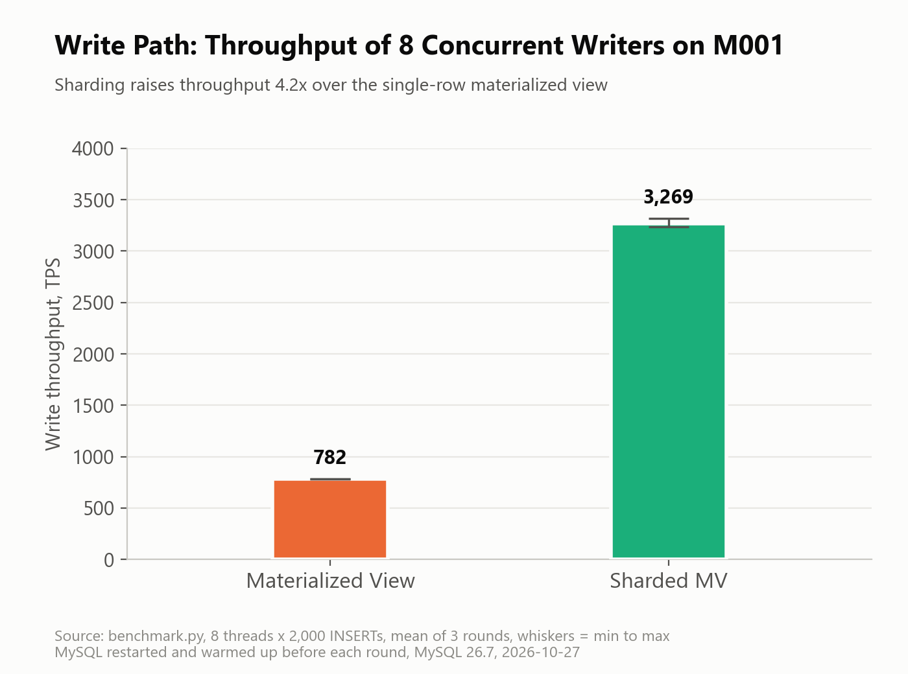
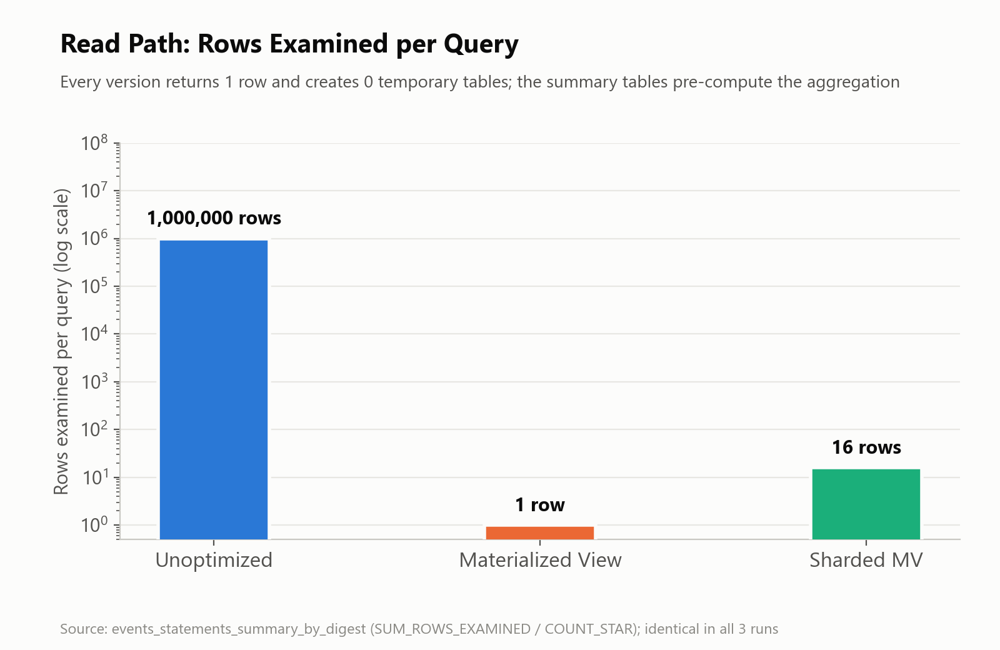
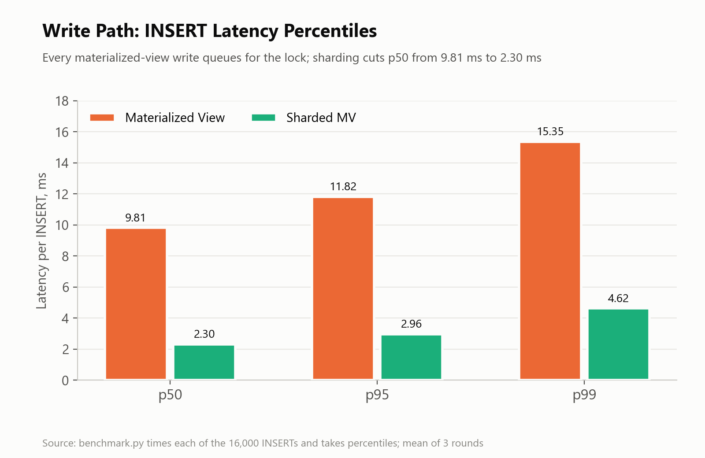
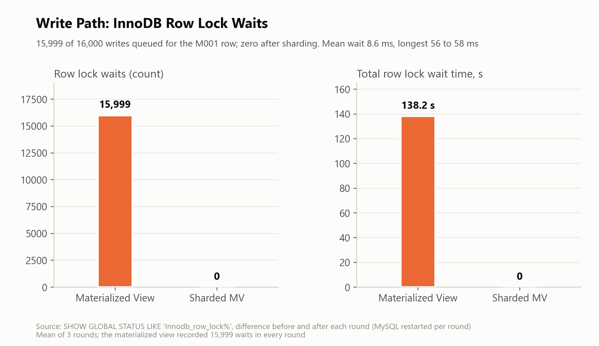

# Materialized Views with Triggers and Sharded Summaries in MySQL

Course project for **ISSS625 Query Processing and Optimisation** (SMU MITB, 2026 Term 1, group project).

MySQL has no native materialized view. This project builds one with a **summary table kept in sync by an `AFTER INSERT` trigger**, finds the problem it creates under concurrent writes (a **hot row**), and fixes that with a **sharded summary table** (16 bucket rows per merchant).

## The problem

A balance query re-sums a merchant's whole history every time:

```sql
SELECT SUM(amount) FROM transactions WHERE merchant_id = 'M001';
```

`idx_merchant` finds the rows, but all ~1,000,000 of them are still read and summed, so the cost grows with the history (O(n)).

## Three versions compared



| Version | Read | Write side effect |
|---|---|---|
| **Unoptimized** | `SUM` over `transactions` (~1M rows for M001) | none |
| **Materialized View** | 1 row by primary key | every insert updates the **same** row → row-lock queue |
| **Sharded MV** | `SUM` over 16 rows | insert updates bucket `txn_id % 16` → contention spread over 16 rows |

The insert and the trigger's update run in one InnoDB transaction, so the summary is always consistent with the committed data.

## Key results

Environment: Windows, MySQL Server 26.7, 10,000,000 synthetic transactions, 100 merchants, hot merchant M001 with 1,000,000 rows.

**Read path** (M001, 3 alternating runs per version, warm cache, `performance_schema`)

| Version | Avg time (ms) | Rows examined | Complexity |
|---|---:|---:|---|
| Unoptimized | 2,153.09 | 1,000,000 | O(n) |
| Materialized View | 6.56 | 1 | O(1) |
| Sharded MV | 16.36 | 16 | O(1) (fixed 16) |

Both summary versions are in the millisecond range. With only 3 runs, 6.6 vs 16.4 ms is noise, so compare their work by rows examined.

**Write path** (8 threads × 2,000 INSERTs on M001, mean of 3 rounds, MySQL restarted before each round)

| Version | TPS | p50 / p95 / p99 (ms) | Row-lock waits | Total lock wait |
|---|---:|---|---:|---:|
| Materialized View | 782.44 | 9.81 / 11.82 / 15.35 | 15,999 | 138.2 s |
| Sharded MV | 3,268.70 | 2.30 / 2.96 / 4.62 | 0 | 0 s |

Sharding gives **4.18× write throughput** and removes the observed row-lock waits. In the materialized view, the average lock wait (~8.6 ms) is almost equal to its p50 latency, so the slowdown is mostly time spent waiting for the lock.

**Connection pool** (supplementary, `pool_wait_benchmark.py`): when 8 threads share a pool of 2 connections, p50 time to get a connection rises to ~704 ms. With a pool of 8 it drops to ~0.5 ms. This shows how long-held locks can lead to pool exhaustion.

|  |  |
|---|---|
|  |  |

Full numbers are in [`results/`](results/). Metric definitions and steps are in [`docs/methodology.md`](docs/methodology.md).

## Trade-offs

- **Benefit:** reads touch 1 or 16 rows instead of ~1M; the balance is up to date as soon as the INSERT commits.
- **Cost:** every INSERT does extra work; storage grows from 100 to 1,600 summary rows; reads sum 16 rows.
- **Best fit:** append-only transactions, frequent balance queries, hot-spot writes.
- **Limits:** the design assumes append-only data (no UPDATE/DELETE triggers). With low write concurrency per merchant, a plain summary table is enough.

## Repository layout

```
sql/
  01_schema.sql              tables + both triggers
  02_load_data.sql           LOAD DATA INFILE for the generated CSV
  03_read_path_metrics.sql   read-path measurement with performance_schema
  04_consistency_check.sql   summaries == SUM(transactions)?
  05_reset_and_backfill.sql  restore 10M rows and rebuild summaries
scripts/
  gen_transactions.py        generate the synthetic dataset (stdlib only)
  benchmark.py               concurrent write + read benchmark, 3 versions
  pool_wait_benchmark.py     connection-pool wait demo
results/                     CSV output of the runs reported above
figures/                     charts
docs/methodology.md          metrics: what, why, how measured
```

## How to reproduce

Requirements: MySQL 8.0+ and Python 3.9+.

```bash
pip install -r requirements.txt
```

1. **Generate the data** (~400 MB, not stored in this repo):

   ```bash
   python scripts/gen_transactions.py --out transactions.csv --seed 42
   ```

   This produces 10M rows for 100 merchants: M001 is fixed at 1,000,000 rows, and the other 9M follow a Zipf (1/k) distribution.

2. **Create the schema and load:** run `sql/01_schema.sql`, then edit the path in `sql/02_load_data.sql` and run it.

3. **Set the database connection.** The scripts read it from environment variables, so no password is in the code:

   ```bash
   # macOS / Linux / Git Bash
   export MYSQL_PASSWORD='your_password'
   # optional: MYSQL_HOST (127.0.0.1), MYSQL_PORT (3306), MYSQL_USER (root), MYSQL_DATABASE (sql_group)
   ```

   ```powershell
   # Windows PowerShell
   $env:MYSQL_PASSWORD = 'your_password'
   ```

4. **Read path:** run `sql/03_read_path_metrics.sql`.

5. **Write path** (restart MySQL before each round, so the lock counters start from 0):

   ```bash
   python scripts/benchmark.py --version materialized --threads 1 --ops 100 --reads 1   # warm-up
   python scripts/benchmark.py --version materialized --threads 8 --ops 2000 --reads 50
   python scripts/benchmark.py --version sharded      --threads 8 --ops 2000 --reads 50
   ```

   Run `SHOW GLOBAL STATUS LIKE 'Innodb_row_lock%';` before and after each run, then `sql/05_reset_and_backfill.sql`.

6. **Pool wait demo:**

   ```bash
   python scripts/pool_wait_benchmark.py --mode direct --threads 8 --ops 20
   python scripts/pool_wait_benchmark.py --mode pool   --threads 8 --ops 20 --pool-size 2
   python scripts/pool_wait_benchmark.py --mode pool   --threads 8 --ops 20 --pool-size 8
   ```

Absolute numbers depend on hardware and MySQL version. The relative differences between versions are the point.

## Data

All data is synthetic, generated by `scripts/gen_transactions.py`. No real customer or merchant data is used.
